# Phase 05 — High‑fidelity UI

The hi‑fi UI is implemented directly in code (`src/next/`) so design and build cannot drift. Screenshots below are from the running build at 390 × 844 (Pixel‑class); all screens are also verified at 360 px and in dark mode.

| | | |
|---|---|---|
| 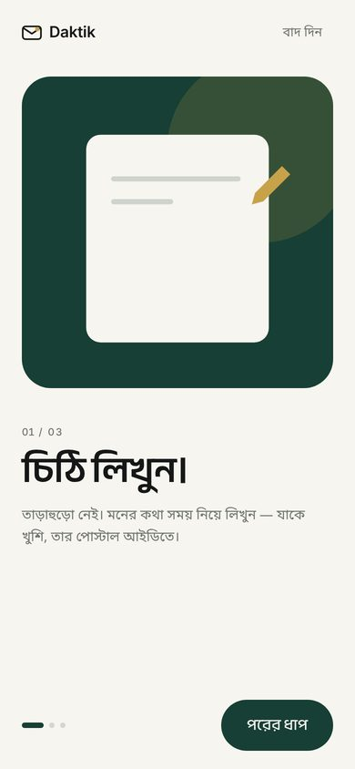 **Onboarding** — 3 steps, one visual each |  **Authentication** — four ways in, nothing else | 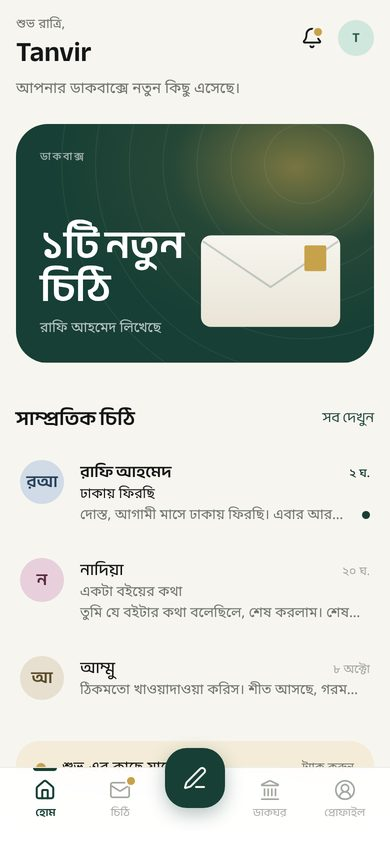 **Home** — greeting, editorial hero, recent letters |
| 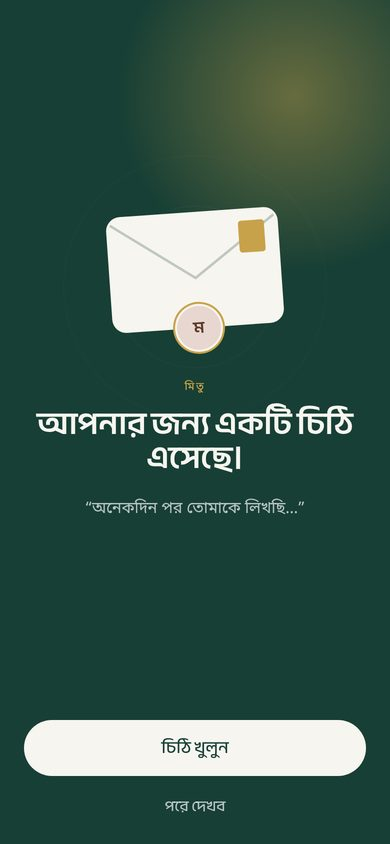 **Arrival** — a quiet full‑screen pause | 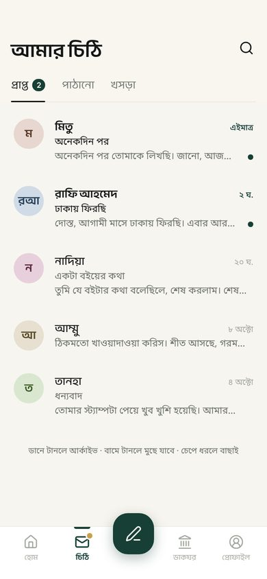 **Letters** — tabs, unread dots, swipe & select | 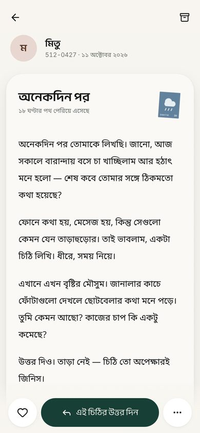 **Reader** — digital paper, stamp, reply in thumb zone |
| 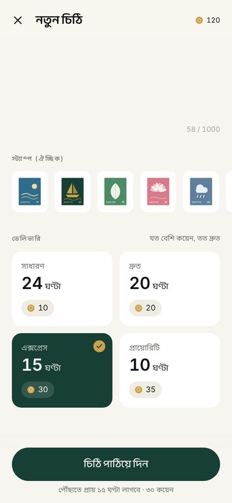 **Compose** — ID lookup, stamp, delivery tickets | 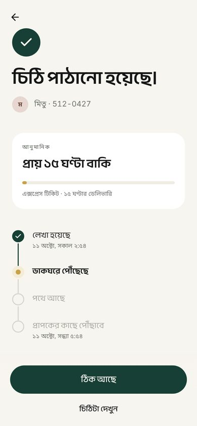 **Delivery** — ETA + soft package tracking | 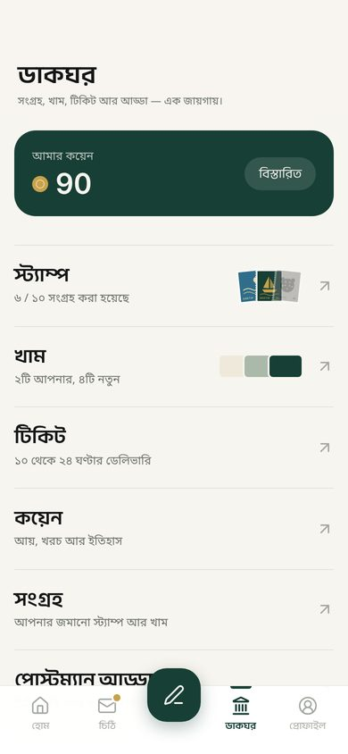 **Post Office** — typographic index, not a card grid |
| 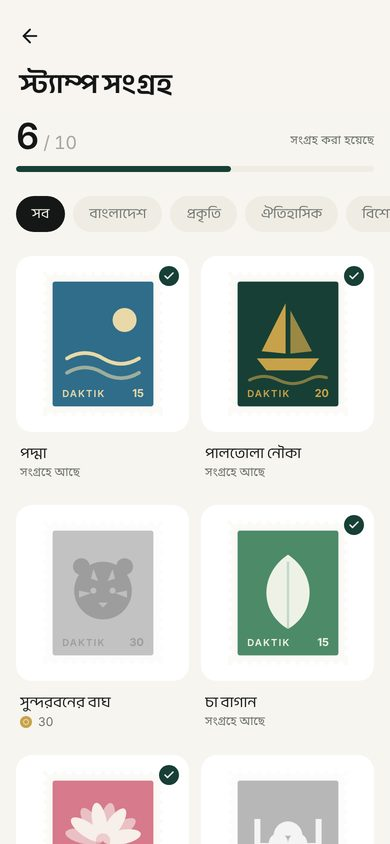 **Stamps** — progress, filters, collected/locked | 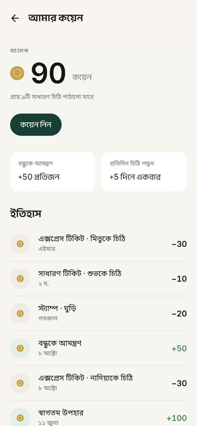 **Coins** — collectible economy, not a bank | 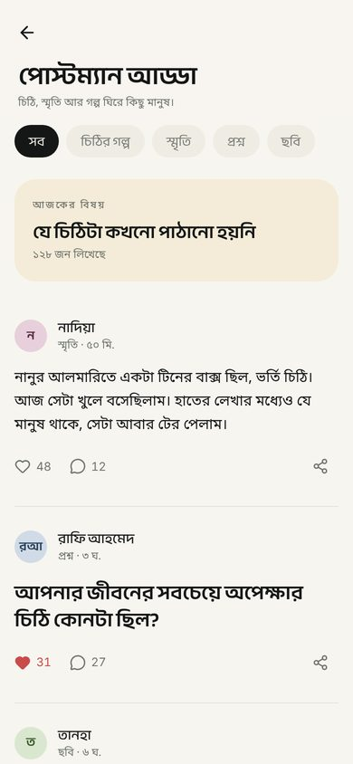 **Postman Adda** — calm, finite, editorial |
| 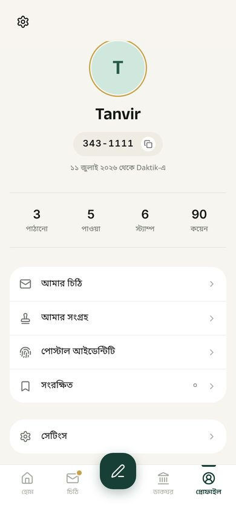 **Profile** — identity first, small numbers |  **Postal Identity** — ID as brand, QR, share | 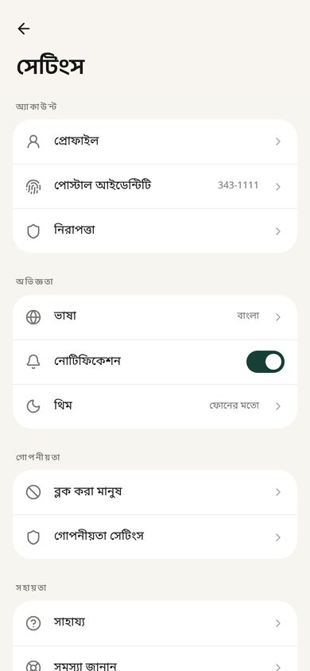 **Settings** — grouped, plain |
| 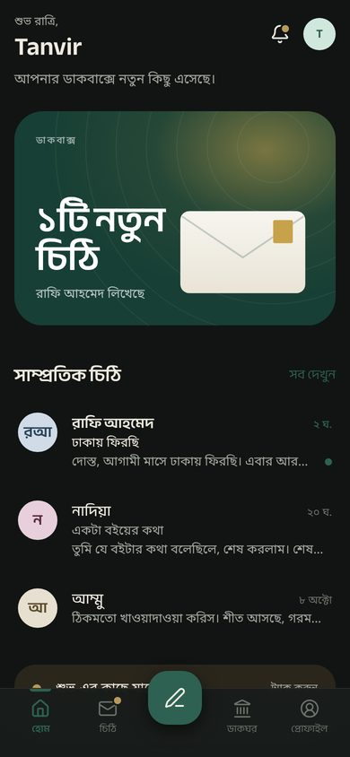 **Dark — Home** | 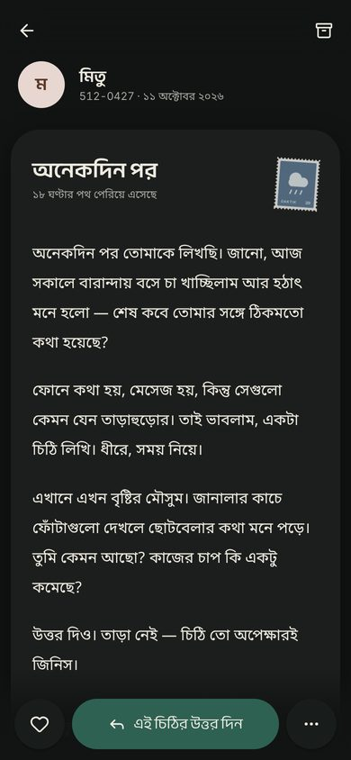 **Dark — Reader** | 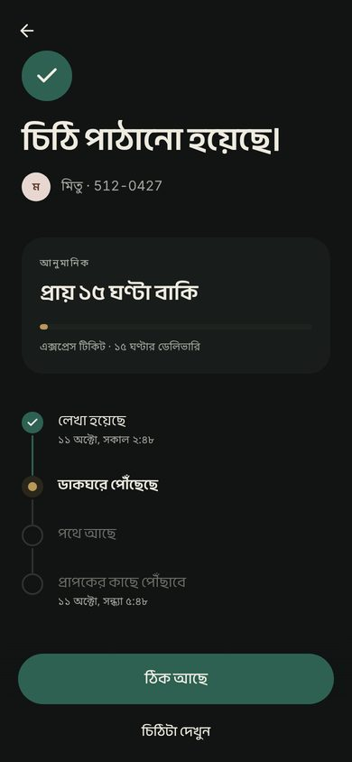 **Dark — Delivery** |

## Screen notes

**Home.** Greeting + one supporting sentence that changes with state (new letters / something in transit / “আজ সব শান্ত।”). The hero is the only large green element; it opens the newest unread letter. Postal identity and activity are a single quiet section at the bottom — stats are inline numbers, not cards.

**Letters.** Rows are separated by whitespace. Unread = semibold name + green dot. Sent rows in transit show the ETA in gold and a hairline progress bar. Swipe right archives (with undo), swipe left deletes (with confirm), long‑press enters selection mode with a contextual header.

**Reader.** The letter fills the screen on a near‑flat paper surface (3.5% grain). Sender, Postal ID and date sit above the paper. The stamp settles onto the corner. Paragraphs fade in sequentially. ♡ / reply / ⋯ are pinned to the bottom.

**Compose.** Recipient Postal ID is formatted as you type and resolved to a person. Subject optional. Body uses the reading style so you write in the same voice you'll be read in. Stamps (owned only) lift when selected. Delivery tickets are clean selectable tiles — hours large, coins as a chip — the selected one fills green.

**Delivery.** Headline states the fact (“চিঠি পাঠানো হয়েছে।”), one panel answers the only question (“প্রায় ১৫ ঘণ্টা বাকি”), the timeline shows the journey.

**Arrival.** Green full screen, envelope settles, sender avatar, first line as a quote, “চিঠি খুলুন” / “পরে দেখব”. Two slow ripples; nothing else moves.

**Post Office.** A typographic index: large section names with one live detail (progress, owned count) and a small preview. Coins sit at the top as a single green strip.

**Stamps.** Generated SVG artwork in a modern, flat, two‑colour style with real perforation. Locked = greyscale at 45%. Detail opens in a bottom sheet.
