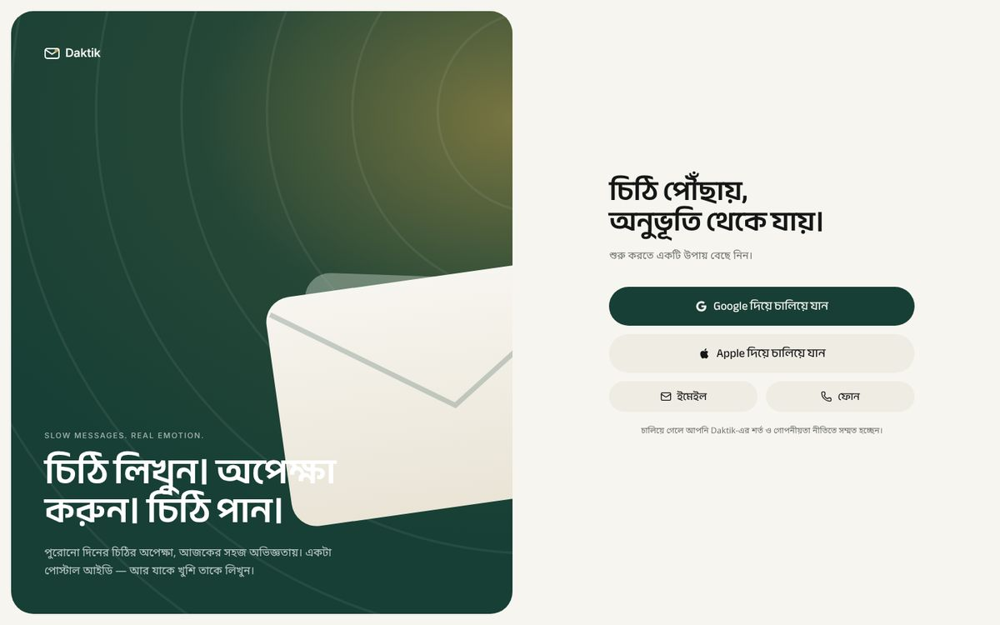
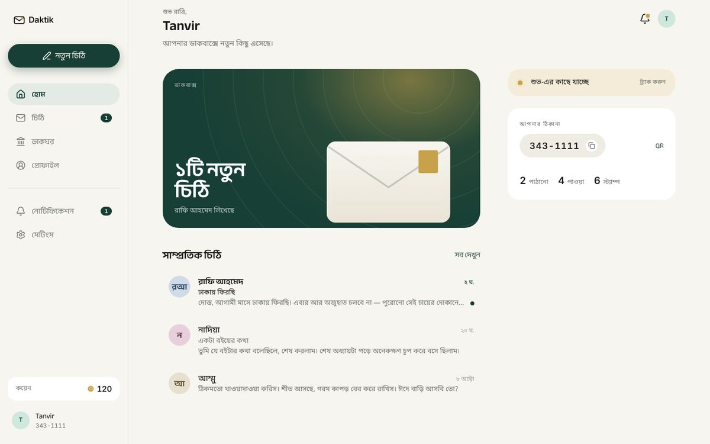
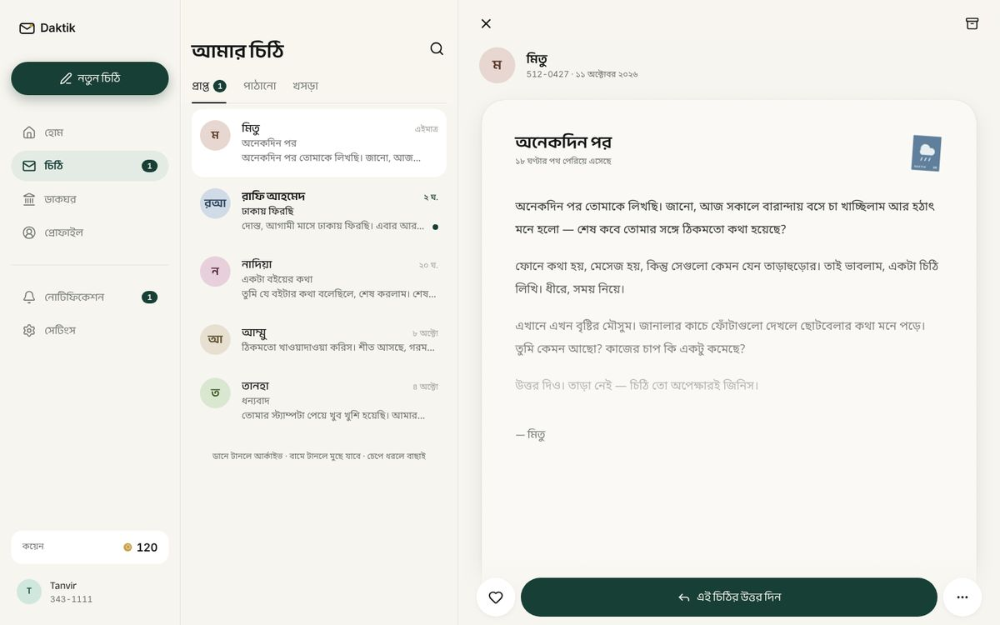
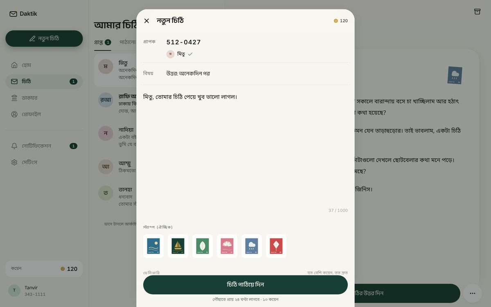
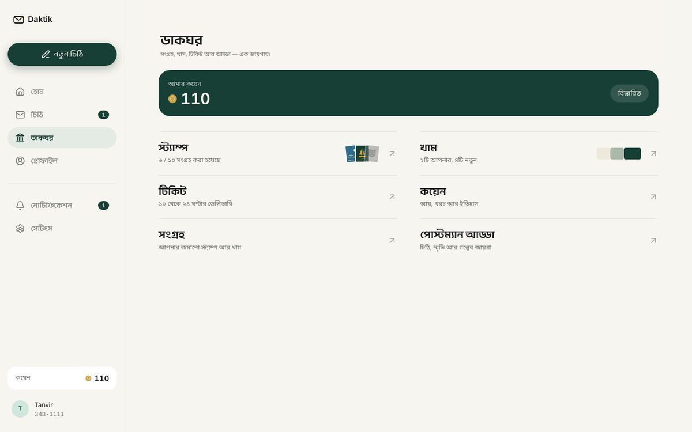

# Website first — Daktik on the web

Daktik ships first as a website, from the same code that will later become the Android app (Capacitor). The new design is now the **default** UI.

## Layouts

| Width | Layout |
|---|---|
| < 1024 px (phones, small tablets) | The mobile app: bottom navigation with raised Compose, full‑screen stacked screens |
| ≥ 1024 px (laptops, desktops) | Website: left sidebar (Compose button, destinations, notifications, settings, coins, identity), content area, **two‑pane inbox** (list + reading pane), Compose / sheets / arrival as centred dialogs |

Signed‑out visitors on desktop see a split page: brand panel on the left, onboarding / sign‑in on the right.

### Screens (1440 × 900)

| | |
|---|---|
|  Sign‑in |  Home |
|  Two‑pane inbox |  Compose dialog |
|  Post Office | |

## Real data (Firebase)

`src/next/data/firebaseStore.tsx` implements the same `DaktikStore` interface as the demo store, on the existing Firebase project and Firestore database. Data is shared with the previous app.

| Feature | Firestore |
|---|---|
| Sign‑in | Firebase Auth: Google, Apple, email + password, phone OTP (invisible reCAPTCHA) |
| Profile / Postal ID | `users/{uid}` — created on first sign‑in with a unique `XXX-XXXX` postcode and 50 welcome coins (same as before) |
| Letters | `letters` — sent in one batch with the coin deduction; `deliveryDelay` = ticket hours |
| Read / ♡ / archive / delete | `isRead`, `isSaved`, `isHidden`, `isBurnt` (rules only allow these fields to change) |
| Drafts | On the device (`localStorage`), private until sent |
| Stamps & envelopes | `users/{uid}/inventory` + `shop_items` (admin‑uploaded stamps appear automatically) |
| Coin history | Derived from sent letters, purchases and coin requests |
| Buying coins | Creates a `requests` doc (`type: coin_purchase`) for an admin to approve — **no online payment yet** |
| Report a problem | `requests` (`type: support_problem`) |
| Notifications | `notifications` (read + mark read) |
| Postman Adda | New `adda_posts` collection — needs the updated rules (below) |

Demo data is still available with `?demo=1` (`?demo=0` to go back). The previous UI: `?ui=legacy`.

## Before going live — one‑time setup

1. **Deploy the updated security rules** (adds `adda_posts`):
   ```bash
   npm i -g firebase-tools
   firebase login
   firebase deploy --only firestore:rules
   ```
2. **Enable sign‑in methods** in Firebase Console → Authentication → Sign‑in method: Google, Email/Password, Phone, Apple (Apple also needs an Apple Developer Services ID).
3. **Authorise the website's domain** in Authentication → Settings → Authorized domains (e.g. `daktik.web.app`, your custom domain).

## Deploy the website (Firebase Hosting)

`firebase.json` and `.firebaserc` are included.

```bash
cd daktik
npm install
npm run build
firebase deploy --only hosting
```

The site is served at `https://gen-lang-client-0688246202.web.app` (and can be given a custom domain in Hosting settings).

## Known limits

* Letter bodies are hidden in the UI until they arrive, but the current rules let a recipient read a letter document as soon as it is sent. Enforcing the wait server‑side needs a Cloud Function or rule change.
* No push notifications on the web yet; arrivals are detected when the site is open (and the newest unseen arrival is shown on the next visit).
* Adda comments, blocked users, privacy settings, language and security settings are placeholders.
